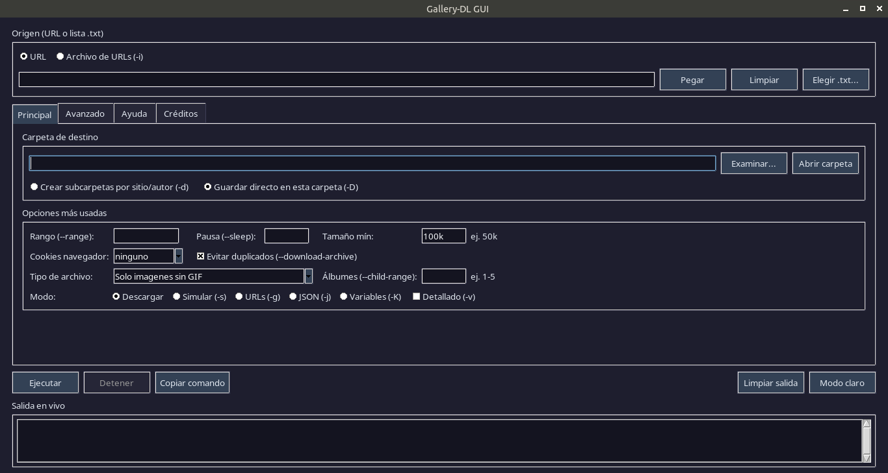

# Gallery-DL GUI

Interfaz gráfica ligera en Python y Tkinter para usar [`gallery-dl`](https://github.com/mikf/gallery-dl) en Linux sin depender de frameworks pesados.



## Características
- Sin dependencias externas (solo Python 3, Tkinter y `gallery-dl`).
- Modo oscuro y claro.
- Opciones principales: URL o lista `.txt` (`-i`), carpeta destino (`-d` / `-D`), rango de imágenes (`--range`), rango de álbumes (`--child-range`), pausa (`--sleep`), tamaño mínimo, cookies de navegador, filtro por tipo de archivo, historial anti-duplicados (`--download-archive`), simulación (`-s`), URLs (`-g`), JSON (`-j`), variables (`-K`) y salida detallada (`-v`).
- Opciones avanzadas: tamaño máximo (`--filesize-max`), límite de velocidad (`-r`), reintentos (`-R`), rango de posts (`--post-range`), metadatos JSON (`--write-metadata`), sobrescribir (`--no-skip`), proxy (`--proxy`), filtro por fecha (`--date-after`), parar tras N omitidos (`-A`), plantilla de nombre (`-f`), espera ante error 429 (`--sleep-429`) y páginas de depuración (`--write-pages`).
- Guarda únicamente sus preferencias en `~/.config/gallery-dl-gui.json`, sin modificar configuraciones globales del sistema.

## Requisitos (Linux)
- `python3` y `python3-tk`
- `gallery-dl` instalado en el `PATH`

En Debian / Ubuntu / antiX:
```bash
sudo apt install python3-tk
```

## Instalación
```bash
git clone https://github.com/KennyWaddell/gallery-dl-gui.git
cd gallery-dl-gui
chmod +x install.sh
./install.sh
```

Para abrirla, búscala en el menú (**Gallery-DL GUI**) o ejecuta:
```bash
gallery-dl-gui
```

## Desinstalación
```bash
./uninstall.sh
```

## Sitios no soportados o con anti-bots
Si una página no está soportada por `gallery-dl` o bloquea descargas automáticas:
1. Usa una extensión de navegador (como **DownThemAll!**, **ImageAssistant** o **Fatkun Batch Download Image**) desde la pestaña abierta.
2. O exporta las URLs de las imágenes a un `.txt` (una por línea) y cárgalo con **Archivo de URLs (`-i`)** en la GUI.

## Créditos
Hecha por **Kenny Waddell**.

## Licencia
GNU GPLv3. Ver [LICENSE](LICENSE).
